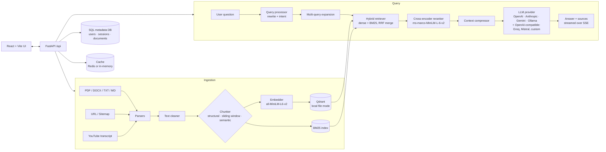

# DocuMind RAG

**Chat with your own documents.** Upload PDFs, Word files, web pages or YouTube videos, then ask questions and get answers with source citations — using a hybrid (vector + BM25) retrieval pipeline and the LLM of your choice.

## Architecture



## Features

- **Many sources** — PDF, DOCX, HTML/URL, whole sitemaps, and YouTube transcripts.
- **Three chunkers** — structural (heading-aware) with a sliding-window fallback for files; sliding window, structural or semantic can be chosen for YouTube ingestion.
- **Hybrid retrieval** — dense vectors in Qdrant + BM25 sparse search, merged with Reciprocal Rank Fusion.
- **Query transformation** — the question is refined, its intent is detected (chit-chat is short-circuited), and it is expanded into extra search queries.
- **Cross-encoder reranking** and TF-IDF based **context compression** before the LLM call.
- **Bring your own LLM** — provider classes for OpenAI, Anthropic, Gemini and Ollama; Groq, Mistral and any OpenAI-compatible endpoint go through the OpenAI client. Users pick a model in the UI; API keys are stored encrypted (Fernet).
- **Streaming answers** over Server-Sent Events, with a phase indicator and source citations.
- **Chat sessions** — history, rename, pin, search, delete, message edit and feedback; long histories are summarised before they are sent to the LLM.
- **Auth** — username/password with JWT, plus Google sign-in.
- **Per-user settings** — custom system prompt and RAG settings (`top_k`, `rerank_k`).
- **Observability** — per-stage timings, JSON trace logs, response and embedding cache, admin stats and BM25 rebuild endpoints.

## Tech stack

| Layer | Tools |
| --- | --- |
| Backend | Python, FastAPI, Uvicorn, Pydantic Settings, SQLAlchemy (async) |
| Retrieval | sentence-transformers, Qdrant (local mode), rank_bm25, CrossEncoder, NLTK / scikit-learn |
| LLMs | OpenAI, Anthropic, Google Gemini, Ollama SDKs / HTTP |
| Ingestion | PyMuPDF, python-docx, BeautifulSoup + lxml, youtube-transcript-api, yt-dlp |
| Storage | PostgreSQL (asyncpg) or SQLite (aiosqlite), optional Redis |
| Frontend | React 19, Vite, react-markdown, @react-oauth/google |

## Quick start

Needs Python 3.10+ and Node.js 18+. For a fully local setup also install [Ollama](https://ollama.com) and run `ollama pull llama3`.

```bash
# 1. Config — copy the example and edit it
cp .env.example .env
# The default DATABASE_URL is PostgreSQL. For a no-server setup add:
#   DATABASE_URL=sqlite+aiosqlite:///./data/metadata.db

# 2. Backend (terminal 1)
python -m venv venv
source venv/bin/activate          # Windows: .\venv\Scripts\activate
cd backend
pip install -r requirements.txt
python -m uvicorn app.main:app --host 0.0.0.0 --port 8000

# 3. Frontend (terminal 2)
cd frontend
npm install
npm run dev
```

Open http://localhost:5173. API docs are at http://localhost:8000/api/docs.

All local data (vectors, BM25 index, uploads) is stored in `data/`. Delete that folder to reset.

## Environment variables

From [`.env.example`](.env.example):

| Variable | Default | Purpose |
| --- | --- | --- |
| `OLLAMA_URL` | `http://localhost:11434` | Local Ollama server |
| `LLM_MODEL` | `llama3` | Default model |
| `LLM_TEMPERATURE` | `0.1` | Low for factual answers |
| `EMBEDDING_MODEL` | `all-MiniLM-L6-v2` | sentence-transformers model |
| `QDRANT_PATH` / `QDRANT_COLLECTION` | `./data/qdrant_storage` / `company_docs` | Vector store location |
| `TOP_K_DENSE` / `TOP_K_SPARSE` / `TOP_K_FINAL` | `20` / `20` / `5` | Retrieval sizes |
| `CHUNK_SIZE` / `CHUNK_OVERLAP` | `512` / `50` | Chunking |
| `SECRET_KEY` | — | JWT signing key — **change it** |
| `ACCESS_TOKEN_EXPIRE_MINUTES` | `60` | Token lifetime |
| `GOOGLE_CLIENT_ID` / `GOOGLE_CLIENT_SECRET` | — | Google sign-in (optional) |
| `VITE_GOOGLE_CLIENT_ID` | — | Google client ID for the frontend |
| `BACKEND_PORT` / `FRONTEND_PORT` | `8000` / `5173` | Ports |

Also read by the backend (see `backend/app/core/config.py`): `DATABASE_URL`, `REDIS_URL` (optional, in-memory cache if empty) and `ENCRYPTION_KEY` (encrypts stored API keys — set your own).

## Project structure

```
backend/
  app/
    api/routes/      auth, query (chat + sessions), ingest, models, admin
    core/            config, JWT security, Fernet key vault
    ingestion/       parsers (pdf, docx, html, youtube), cleaner, chunkers, embedder, pipeline
    rag/             query processor/transformer, hybrid retriever, BM25, reranker,
                     compressor, context builder, prompts, observability, pipeline
    providers/       OpenAI, Anthropic, Gemini, Ollama + model catalog
    storage/         Qdrant vector store, SQL metadata DB, cache
  eval_rag_quality.py   small retrieval smoke test
frontend/            React + Vite chat UI
app.py, api.py       first version: Streamlit + LangChain + FAISS demo (kept for reference)
```
