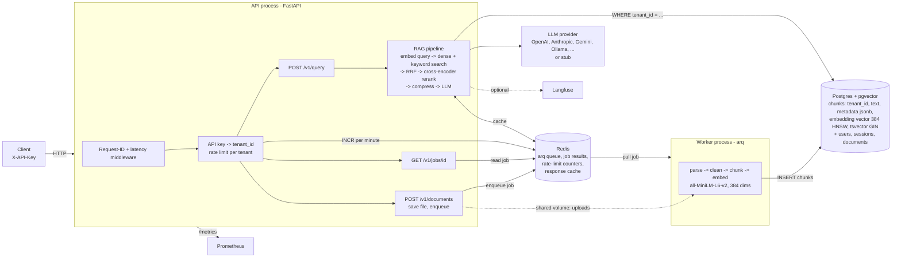

# DocuMind platform architecture

DocuMind is a RAG service: tenants upload documents, then ask questions and get answers
with sources. This page covers the multi-tenant platform API (`/v1`). The original single-user
UI API (`/api/*`, React front end) still runs on the same app and storage.

Numbers below are measured on one laptop; see [BENCHMARKS.md](BENCHMARKS.md) for how.

## System diagram

## Data flow

**Ingest (asynchronous)**

1. `POST /v1/documents` with `X-API-Key`. The key is hashed and mapped to a `tenant_id`.
   The per-tenant rate limit is checked in Redis.
2. The API checks the file type and size, writes the file to the shared uploads volume,
   enqueues `ingest_file_job(path, filename, tenant_id)` in arq, and returns `202 {job_id}`.
   Measured: 60 uploads accepted in 0.29–0.39 s from one client, about 5–7 ms each.
3. The worker picks the job, runs the existing ingestion pipeline (parse, clean, structural
   chunker with sliding-window fallback, batch embed), and inserts the chunks into Postgres
   with `tenant_id` as a real column. It deletes the upload, then bumps the response-cache
   version in Redis so the API stops serving answers from before this document.
4. `GET /v1/jobs/{job_id}` returns `queued | in_progress | complete` and the result
   (chunks stored or the error). A job that belongs to another tenant returns 404, the same as
   a job that does not exist.

**Query (synchronous)**

1. `POST /v1/query` → tenant from the key, then rate limit.
2. Response cache lookup. The key includes tenant, user, filters, model and the corpus version.
3. Query rewrite and multi-query expansion (LLM; falls back to the raw query if the LLM fails).
4. For each query: embed it, run pgvector cosine search **and** Postgres full-text search,
   both `WHERE tenant_id = $tenant`, then merge with Reciprocal Rank Fusion.
5. Cross-encoder rerank (`ms-marco-MiniLM-L-6-v2`), context compression, LLM answer, sources.

## Components

| Component | Code | Job |
| --- | --- | --- |
| API | `backend/app/main.py`, `api/routes/v1.py` | Auth, rate limit, enqueue, job status, query |
| Tenancy | `core/tenancy.py` | `TENANT_API_KEYS` → sha256 → tenant; fixed-window limit in Redis |
| Worker | `backend/app/worker.py` | arq worker; loads the embedding model once, runs ingestion jobs |
| Ingestion | `ingestion/pipeline.py` | Parsers, cleaner, chunkers, embedder (unchanged; now takes `tenant_id`) |
| Vector store | `storage/vector_store.py`, `storage/pgvector_store.py` | `VectorStore()` returns Qdrant or pgvector; same methods |
| Keyword search | `rag/bm25_index.py` / `PgKeywordIndex` | BM25 pickle (Qdrant mode) or Postgres FTS (pgvector mode) |
| RAG pipeline | `rag/pipeline.py` | Retrieve, rerank, compress, generate; adds `tenant_id` to every search |
| Cache | `storage/cache.py` | Response + embedding cache; corpus version in Redis |
| Telemetry | `core/telemetry.py` | JSON logs with request id, Prometheus metrics, optional Langfuse |

## How tenant isolation is enforced

- The tenant comes only from the API key. The request body has no tenant field.
- `RAGPipeline` sets `search_filters["tenant_id"]` **after** merging caller filters, so a
  request filter cannot point at another tenant (tested: `test_pipeline_filters_every_search_by_tenant`).
- `PgVectorStore.search` and `keyword_search` raise if there is no `tenant_id` filter, so a
  new code path that forgets the filter fails loudly instead of leaking (tested).
- Job status checks the job's `tenant_id` and answers 404 for other tenants (tested).
- Cache keys include the tenant, so a cached answer cannot cross tenants.
- The tenant name `default` is reserved for the legacy `/api` data and is refused in `TENANT_API_KEYS`.
- `/metrics` has no auth and carries no tenant names; expose it on the internal network only.
- Not done: Postgres row-level security. Today isolation is in the application layer;
  RLS with `SET app.tenant_id` per connection would be the defence-in-depth step.

## Trade-offs

**Why pgvector and not FAISS (or the existing local Qdrant)?**

- The repo had Qdrant in local file mode (FAISS was only in the first Streamlit demo).
  Local Qdrant locks its folder to one process. The moment ingestion moves to a separate
  worker process, the API and the worker cannot both open it. Same problem with FAISS:
  an in-process index file has no concurrent writers and no shared state across replicas.
- Postgres was already the metadata database. Putting vectors in the same database gives one
  backup, one connection string, transactions, and filters as plain SQL (`WHERE tenant_id = ...`
  on an indexed column) instead of a second system to keep in sync.
- The BM25 index was a pickle in each process, rebuilt after each upload. With a separate
  worker, the API's copy would go stale. Postgres full-text search (`tsvector` + GIN) is
  updated by the same `INSERT`, so keyword search is always current. On the 15-question eval
  set, retrieval scores are the same on both backends (hit@5 1.00, MRR 0.97), but that set
  has only 8 chunks, so it shows "no loss here", not "equal everywhere".
- Cost: pgvector is slower than a dedicated vector DB at large scale, and HNSW with a `WHERE`
  filter can return fewer than k rows when one tenant is a small share of the table (the index
  is searched first, then filtered). pgvector 0.8 `hnsw.iterative_scan` (the compose image)
  or a partial index or partition per large tenant fixes that.
- Qdrant stays the default for the single-user, no-server setup (`VECTOR_BACKEND=qdrant`).

**Why a queue (Redis + arq)?**

- Ingestion is slow and CPU-heavy: 0.2–0.5 s per small markdown file here (worker log), seconds to minutes for a
  large PDF or a sitemap crawl. Before, it ran in FastAPI `BackgroundTasks` inside the API
  process: it competed with queries for CPU, the status lived in a Python dict (lost on restart,
  invisible to other replicas), and a crash lost the job.
- With a queue: the API returns in milliseconds, workers scale on their own, job state and
  results live in Redis, `max_tries` retries a job cut off by a worker restart, and queue depth
  is a metric you can alert on.
- Why arq and not RQ or Celery: RQ needs `fork()` and does not run on Windows (this was built
  on Windows). Celery is much bigger than this needs. arq is small, asyncio-native like
  FastAPI, and uses Redis, which the cache already used.
- Cost: one more process and Redis becomes critical (it holds the queue). Redis runs with
  AOF on and `noeviction`, because the old `allkeys-lru` setting could silently evict queued jobs.

**Why rate limit in Redis with a fixed window?** All API replicas share one counter. A fixed
one-minute window is one `INCR` + `EXPIRE` per request. It allows up to 2x the limit across a
window edge; a sliding window or token bucket fixes that if it matters.

**Why API keys in an env var?** Smallest thing that gives each tenant its own key. Only
sha256 hashes are compared, with `hmac.compare_digest`. A `tenants` table with self-serve key
rotation is the next step.

## Scaling limits (measured and expected)

Measured on one laptop (i5-1155G7, 4 cores / 8 threads, 16 GB, Windows 11, everything local,
stub LLM). Details in [BENCHMARKS.md](BENCHMARKS.md).

1. **Reranking CPU is the first wall.** The cross-encoder rerank is 74–84% of query time
   (retrieval in Postgres is about 120–140 ms). Embedding and reranking run synchronously in the
   async handler, so one process serves one query at a time. Measured: throughput tops out at
   about 2.1–2.3 req/s on this laptop and p50 grows with users (3.7 s at 10, 10 s at 25).
   Four API processes did **not** raise it: with default torch threads they fought over the 8 CPU
   threads and got slower (0.48–1.0 req/s, some 500s); with 2 threads each they matched one process.
   So the box is CPU-bound. Fixes, in order: rerank fewer candidates (check with the evals),
   a quantized / ONNX reranker, a GPU inference service shared by API replicas, then more machines.
2. **The real LLM dominates in production.** These numbers use a stub LLM, so they measure the
   platform, not the model. A hosted LLM adds roughly 0.5–5 s per answer and has its own
   rate limits; the response cache and streaming (`/api/query` already streams over SSE) matter more then.
3. **Ingestion should scale with workers (not measured beyond one).** One worker with 2 concurrent jobs did about 200–230 docs/min
   (about 1,600–1,800 chunks/min) for 2.7 KB markdown files. Embedding is the cost, so add workers
   (CPU) or batch across jobs.
4. **pgvector:** a single HNSW index is fine into the low millions of 384-dim vectors on one
   node. Past that: partition by tenant, tune `m` / `ef_construction`, read replicas for search,
   or move vectors to a dedicated store behind the same `VectorStore` interface.
5. **Redis** is a single node here. It is fine for queue and counters at this size; use a
   managed Redis with persistence before treating it as durable.
